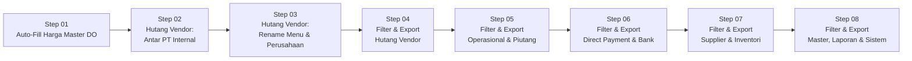

# Plan Utama: Auto-Fill Komponen Biaya DO, Pembaruan Hutang Vendor, serta Standarisasi Filter & Export Excel/PDF Seluruh Menu

## Goal Description

Rencana implementasi menyeluruh dari catatan pengguna (dengan bagian *Piutang (Faktur)* yang dicoret dilewati sesuai konfirmasi):

1. **DO Belum Kembali & DO Kembali:** Memperbaiki auto-fill nominal komponen biaya dari harga master (`cost_component.price`) saat komponen dipilih di halaman edit order.
2. **Hutang Vendor:**
   - Mengizinkan pembuatan nota/faktur, sinkronisasi, cetak PDF, dan pembayaran untuk **order antar PT Internal** (armada `Internal` dengan `fleet.company.companyCode != customer.companyCode`), menggunakan `vendorPrice` (jika `> 0`) atau `personalVendorPrice`.
   - Mengganti nama menu pertama (`VENDOR_ORDER_WAITING` / `vendor/order/waiting`) dari **"Order Menunggu Faktur"** menjadi **"Faktur yg Belum Dibayar"** (menu ke-2 tetap **"Faktur Vendor Belum Lunas"**).
   - Mengganti istilah dan tampilan **"Format"** (`PHL`, `WTMS`, `Pribadi`) menjadi **"Perusahaan"** (`customer.company.name`) di tabel & modal Hutang Vendor.
3. **Standarisasi Filter & Export Excel/PDF Seluruh Menu:** Menambahkan Filter Card standar (`phl-table-design` §3, light + dark mode) serta Export Excel & PDF pada seluruh menu aplikasi yang belum lengkap, dipecah bertahap per modul.

---

## User Review Required & Open Questions

> [!IMPORTANT]
> **Keputusan Terkonfirmasi:**
> - **Cakupan Filter & Export Excel/PDF:** Seluruh menu aplikasi, dibagi per modul (`step-04` s/d `step-08`).
> - **Faktur Antar PT Internal:** Order armada `Internal` dengan `fleet_company.companyCode != customer.companyCode`, nominal dasar dari `vendorPrice` (> 0) atau `personalVendorPrice`.
> - **Penamaan Menu:** `VENDOR_ORDER_WAITING` -> `"Faktur yg Belum Dibayar"`, `VENDOR_INV_UNPAID` tetap `"Faktur Vendor Belum Lunas"`.
> - **Piutang (Faktur) yang dicoret:** Dilewati.

> [!WARNING]
> **Pertimbangan Data Historis (Step 02):**
> Perluasan `findWaitingOrders()` untuk order antar PT Internal akan menampilkan order historis antar PT Internal yang belum memiliki `vendor_payment`. Jika perlu pembatasan tanggal mulai (mis. `orderDate >= '2026-10-01'`), konfirmasi sebelum eksekusi Step 02.

---

## Daftar & Tautan Action Step-by-Step

| Step | Judul | Target File Utama | Status | Action File |
| :---: | :--- | :--- | :---: | :--- |
| 01 | Auto-Fill Harga Master Komponen Biaya DO | `not-return-do/components/cost-edit.blade.php`, `return-do/components/cost-edit.blade.php` | `pending` | [step-01-autofill-harga-master-komponen-biaya-do.md](./implementasi-catatan-operasional-vendor-filter-export/step-01-autofill-harga-master-komponen-biaya-do.md) |
| 02 | Hutang Vendor: Faktur Antar PT Internal | `VendorPaymentService.php`, `VendorInvoiceController.php` | `done` | [step-02-hutang-vendor-antar-pt-internal.md](./implementasi-catatan-operasional-vendor-filter-export/step-02-hutang-vendor-antar-pt-internal.md) |
| 03 | Hutang Vendor: Rename Menu & Kolom Perusahaan | Migration `menu`, `MenuSeeder.php`, `VendorInvoiceController.php`, `waiting.blade.php`, `modals.blade.php` | `done` | [step-03-hutang-vendor-rename-menu-dan-kolom-perusahaan.md](./implementasi-catatan-operasional-vendor-filter-export/step-03-hutang-vendor-rename-menu-dan-kolom-perusahaan.md) |
| 04 | Filter & Export Excel/PDF: Hutang Vendor (5 Submenu) | `routes/vendor.php`, `VendorInvoiceController`, `VendorPaymentListController`, `VendorPaymentService`, views & exports vendor | `done` | [step-04-filter-export-hutang-vendor.md](./implementasi-catatan-operasional-vendor-filter-export/step-04-filter-export-hutang-vendor.md) |
| 05 | Filter & Export Excel/PDF: Operasional & Piutang | `OrderController`, `ReturnDoController`, `InvoiceController`, `InvoicePaymentController`, `InvoicePaymentTransactionController` | `done` | [step-05-filter-export-operasional-dan-piutang.md](./implementasi-catatan-operasional-vendor-filter-export/step-05-filter-export-operasional-dan-piutang.md) |
| 06 | Filter & Export Excel/PDF: Pembayaran Langsung & Kas/Bank | `DirectPaymentController`, `BankAccountController`, `UserBankController`, `BankBookController` | `done` | [step-06-filter-export-pembayaran-langsung-dan-bank.md](./implementasi-catatan-operasional-vendor-filter-export/step-06-filter-export-pembayaran-langsung-dan-bank.md) |
| 07 | Filter & Export Excel/PDF: Supplier & Inventori | `PurchaseController`, `DirectPurchaseController`, `PurchasePaymentController`, `Inventory/*`, `MaintenanceController` | `done` | [step-07-filter-export-supplier-dan-inventori.md](./implementasi-catatan-operasional-vendor-filter-export/step-07-filter-export-supplier-dan-inventori.md) |
| 08 | Filter & Export Excel/PDF: Master, Laporan & Sistem | `Master/*`, `Data/RouteController`, `Report/*`, `UserController`, `RoleController`, `ActivityLogController` | `done` | [step-08-filter-export-master-laporan-dan-sistem.md](./implementasi-catatan-operasional-vendor-filter-export/step-08-filter-export-master-laporan-dan-sistem.md) |

---

## Verification Plan (Akhir)

1. **Syntax & Blade Compilation:** `php -l` pada seluruh PHP controller/service/export baru & diubah, serta uji kompilasi Blade.
2. **Route & Migration Check:** `php artisan route:list` dan `php artisan migrate --status`.
3. **Automated Tests:** `php artisan test` (termasuk unit/feature test untuk logika antar PT Internal dan endpoint export).
4. **UI & Dark Mode Verification:** Uji manual semua halaman yang diubah di mode terang & gelap sesuai checklist `phl-table-design` §3.
