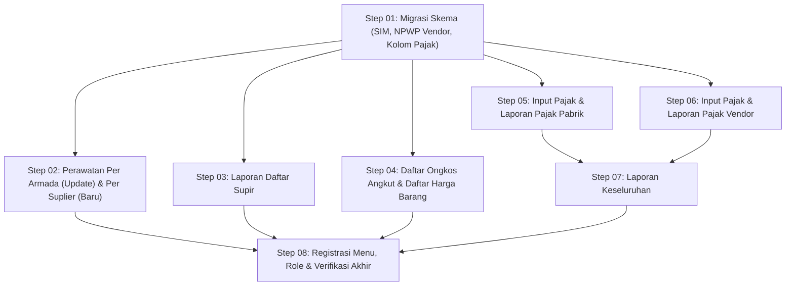

# Plan Implementasi Laporan Lengkap PHL (8 Sheet)

## 1. Goal Description

Melengkapi dan menyelaraskan 8 laporan berdasarkan template Excel bisnis PHL agar seluruh laporan tersedia di sistem secara seragam (DataTable server-side, filter standar light/dark mode sesuai `phl-table-design`, global search sesuai `datatable-search-standard`, serta export Excel & PDF):

1. **LAPORAN KESELURUHAN** — Rekap order end-to-end (Info Order, Blok Pabrik/Invoice, Blok Komisi, Blok Vendor/Nota Pembayaran, Untung, Keterangan).
2. **Daftar Ongkos Angkut** — Daftar tarif rute termasuk `Tgl Input`, `Harga Pabrik`, `Harga Vendor Pribadi`, `Nama Vendor`, dan `Harga Vendor External`.
3. **Daftar Harga Barang** — Daftar harga item per supplier lengkap dengan `Tgl Input`.
4. **Laporan Pajak Pabrik** — Menu inputan pajak tersendiri + laporan pajak invoice pabrik dengan rumus `DPP Lain = DPP × 11/12` dan `PPN = DPP Lain × 12%`.
5. **LAPORAN PAJAK VENDOR** — Menu inputan pajak tersendiri + laporan pajak nota pembayaran vendor.
6. **DAFTAR SUPIR** — Laporan khusus supir (Nama Supir, Tgl Masuk, NIK, SIM, Alamat, No HP, Masa Kerja).
7. **LAPORAN Perawatan Per Armada** — Penyesuaian `report/maintenance-fleet` agar menampilkan Total Pembayaran, Utang Jatuh Tempo, Total Utang, Tgl Jatuh Tempo, Status (Lunas/Belum), serta filter Supplier pada halaman detail.
8. **LAPORAN Perawatan Per Suplier** — Laporan baru berbasis maintenance yang dikelompokkan per Supplier (halaman depan ringkasan + halaman detail dengan filter Perusahaan & No Polisi).



---

## 2. User Review Required & Open Questions

> [!IMPORTANT]
> Beberapa keputusan bisnis berikut perlu dikonfirmasi sebelum eksekusi step terkait agar tidak ada perbedaan ekspektasi dengan tim operasional/finance:

1. **Blok "Customer" di Sheet 1 (`LAPORAN KESELURUHAN`)**:
   - Di header Excel tertulis `Customer`, namun isi kolomnya adalah `Tgl Terima SJ`, `No. Nota Pembayaran`, `DP`, `Tgl Bayar`, `Lunas/Belum` — di sistem PHL, `Nota Pembayaran` merujuk pada **Hutang Vendor (`vendor_payment`)** / **Pembayaran Langsung (`order_payment`)**, sedangkan tagihan ke Customer/Pabrik merujuk pada **Invoice (`invoice`)**.
   - **Asumsi default di plan**: Blok kiri (`Pabrik`) bersumber dari `invoice` (Piutang/AR), dan blok kanan (`Customer`/Nota Pembayaran) bersumber dari `vendor_payment` / `order_payment` (Hutang Vendor/AP). Mohon konfirmasi bila berbeda.
2. **Relasi Utang & Jatuh Tempo pada Perawatan (Step 02)**:
   - Data `maintenance` terhubung ke `purchase` melalui tabel pivot `maintenance_purchase` (`dueDate`, `nominal`, `paidAmount`, `paymentStatus`).
   - **Asumsi default**: Jika satu `maintenance` terhubung ke satu atau lebih PO, nilai `Total Pembayaran`, `Utang Jth Tempo`, `Total Utang`, dan `Status (Lunas/Belum)` dihitung dari PO terkait; jika item berasal dari stok tanpa PO tertaut, status ditampilkan `-` / `Tanpa PO` dan utang `0`.
3. **Sumber `Tgl Input` pada Daftar Harga Barang (Step 04)**:
   - **Asumsi default**: Menggunakan `item.updated_at` (atau `created_at` jika belum pernah diubah) sebagai `Tgl Input` harga saat ini. Jika dibutuhkan riwayat perubahan harga historis per tanggal, perlu tabel log tambahan (`item_price_logs`).
4. **Cakupan Laporan Pajak Vendor (Step 06)**:
   - **Asumsi default**: Mengambil dari `vendor_payment` (Nota Pembayaran Vendor) dan opsional mencakup `order_payment` (Direct Payment) via filter tipe pembayaran.

---

## 3. Daftar & Tautan Action Step-by-Step

| Step | Judul Langkah | Target Utama | Status | Dokumen Detail |
| :-: | :--- | :--- | :---: | :--- |
| 01 | Migrasi Skema Pajak, SIM & NPWP Vendor | `database/migrations/*`, `Employee`, `FleetCompany`, `Invoice`, `VendorPayment` | `done` | [step-01-migrasi-skema-pajak-sim-npwp.md](./laporan-lengkap-phl/step-01-migrasi-skema-pajak-sim-npwp.md) |
| 02 | Perawatan Per Armada (Update) & Perawatan Per Suplier (Baru) | `MaintenancePerFleetController`, `MaintenancePerSupplierController` [NEW] | `done` | [step-02-perbaikan-perawatan-armada-dan-laporan-perawatan-suplier.md](./laporan-lengkap-phl/step-02-perbaikan-perawatan-armada-dan-laporan-perawatan-suplier.md) |
| 03 | Laporan Daftar Supir & Input SIM | `DriverReportController` [NEW], `EmployeeController`, `EmployeeExport` | `done` | [step-03-laporan-daftar-supir.md](./laporan-lengkap-phl/step-03-laporan-daftar-supir.md) |
| 04 | Laporan Daftar Ongkos Angkut & Daftar Harga Barang | `FreightRateReportController` [NEW], `ItemPriceReportController` [NEW] | `done` | [step-04-laporan-daftar-ongkos-angkut-dan-harga-barang.md](./laporan-lengkap-phl/step-04-laporan-daftar-ongkos-angkut-dan-harga-barang.md) |
| 05 | Menu Input Pajak & Laporan Pajak Pabrik | `FactoryTaxController` [NEW], `FactoryTaxReportExport` [NEW] | `done` | [step-05-menu-input-pajak-dan-laporan-pajak-pabrik.md](./laporan-lengkap-phl/step-05-menu-input-pajak-dan-laporan-pajak-pabrik.md) |
| 06 | Menu Input Pajak & Laporan Pajak Vendor | `VendorTaxController` [NEW], `FleetCompanyController`, `VendorTaxReportExport` [NEW] | `done` | [step-06-menu-input-pajak-dan-laporan-pajak-vendor.md](./laporan-lengkap-phl/step-06-menu-input-pajak-dan-laporan-pajak-vendor.md) |
| 07 | Laporan Keseluruhan (End-to-End Order) | `OverallReportController` [NEW], `OverallReportService` [NEW], `OverallReportExport` [NEW] | `done` | [step-07-laporan-keseluruhan.md](./laporan-lengkap-phl/step-07-laporan-keseluruhan.md) |
| 08 | Registrasi Menu, Role & Verifikasi Akhir | `MenuSeeder`, `RoleMenuSeeder`, Feature Tests | `done` | [step-08-registrasi-menu-role-dan-verifikasi-akhir.md](./laporan-lengkap-phl/step-08-registrasi-menu-role-dan-verifikasi-akhir.md) |

---

## 4. Verification Plan (Akhir)

Setelah seluruh step (`step-01` s/d `step-08`) selesai dikerjakan:

```bash
# 1. Jalankan migrasi & seeder menu/role
php artisan migrate
php artisan db:seed --class=MenuSeeder
php artisan db:seed --class=RoleMenuSeeder

# 2. Verifikasi route seluruh laporan baru & update
php artisan route:list --path=report
php artisan route:list --path=datatable

# 3. Syntax check seluruh controller, service, dan export baru/terubah
find app/Http/Controllers/Report app/Services/Report app/Exports -name "*.php" -exec php -l {} \;

# 4. Jalankan suite test
php artisan test --filter=Report
```
