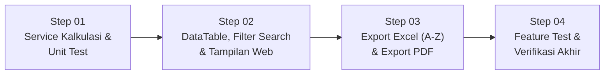

# Plan Utama: Pembaruan Laporan Detail Pesanan (Omset Perkalian, Antar PT Internal, Komisi, Gaji, Pajak & Laba Bersih)

## Goal Description

Memperbarui **Laporan Detail Pesanan (`Order Detail Report`)** pada tampilan Web DataTable, Export Excel (langsung & chunked), dan Export PDF sesuai rincian kebutuhan bisnis:

1. **Tampilan Perkalian Omset (3 Kolom Terpisah):** Memecah kolom omset menjadi **Qty**, **Harga Satuan**, dan **Total Omset** di Web, PDF, maupun Excel.
2. **Omset Mobil Beda PT Antar Internal Mengikuti Harga Vendor:** Jika armada bertipe `Internal` memiliki Perusahaan Induk (`fleet.company.companyCode`) yang **berbeda** dengan Perusahaan Customer (`customer.companyCode`), maka Harga Satuan dan Total Omset menggunakan harga vendor (`vendorPrice` / `vendorPriceSingle` jika `> 0`, fallback ke `personalVendorPrice` / `personalVendorPriceSingle`), konsisten dengan `VendorPaymentService::resolveOrderVendorLineAmounts()`. Order selain itu (sama PT atau armada `External`) tetap menggunakan harga jual rute customer (`price` & `routeAmount`).
3. **Pemisahan Kolom Komisi & Gaji:** Mengeluarkan komponen biaya **Komisi** (`cost_component.type = 'commission'` atau nama mengandung `komisi`) dan **Gaji** (`cost_component.type = 'salary'` atau nama mengandung `gaji`) dari kolom `Detail Biaya (Tidak Ditagihkan)` ke kolom tersendiri, sementara `Total Biaya (Tidak Ditagihkan)` tetap menjumlahkan seluruh biaya non-On Charge (`Biaya Lainnya + Komisi + Gaji`).
4. **Potongan Pajak & Laba Bersih:** Menampilkan 3 kolom profitabilitas di bagian akhir: **Laba Kotor (Sebelum Pajak)**, **Potongan Pajak (PPh)** (menggunakan `ProfitLossService::resolveOrderTax()` dari prorata PPh Invoice atau PPh Direct Payment), dan **Laba Bersih (Setelah Pajak)**.

---

## User Review Required & Keputusan Terkonfirmasi

> [!IMPORTANT]
> **Keputusan Desain Terkonfirmasi:**
> - **Format Perkalian Omset:** Dipisah menjadi **3 kolom tersendiri** (`Qty`, `Harga Satuan`, `Total Omset`) di Web, PDF, dan Excel.
> - **Aturan Beda PT Antar Internal:** Berlaku saat `fleet.company.type === 'Internal'` serta `fleet.company.companyCode` dan `customer.companyCode` keduanya terisi namun berbeda (`fleetCompanyCode !== customerCompanyCode`).
> - **Total Biaya (Tidak Ditagihkan):** Komisi dan Gaji tampil di kolom masing-masing (tidak muncul ganda di `Detail Biaya`), sedangkan `Total Biaya` tetap menjumlahkan `Biaya Lainnya + Komisi + Gaji`.
> - **Kolom Pajak & Laba:** Ditampilkan lengkap 3 kolom di akhir: `Laba Kotor (Sebelum Pajak)`, `Potongan Pajak (PPh)`, dan `Laba Bersih (Setelah Pajak)`.

> [!NOTE]
> **Optimasi Export Chunked Excel:**
> Endpoint `excelOrderDetailChunk` akan menyimpan array baris terhitung (`prepared row DTO`) ke `Cache` alih-alih objek model Eloquent mentah beserta relasi bersarang `invoiceDetail.invoice.details`, sehingga ukuran cache tetap ringan dan bebas masalah serialisasi.

---

## Daftar & Tautan Action Step-by-Step

| Step | Judul | Target File Utama | Status | Action File |
| :---: | :--- | :--- | :---: | :--- |
| 01 | Service Kalkulasi Order Detail & Unit Test | `OrderDetailReportService.php`, `OrderDetailReportCalculationTest.php` | `done` | [step-01-service-kalkulasi-order-detail.md](./order-detail-report-omset-komisi-gaji-pajak/step-01-service-kalkulasi-order-detail.md) |
| 02 | Pembaruan DataTable, Pencarian Global & Tampilan Web | `OrderDetailController.php`, `resources/views/report/order-detail/index.blade.php`, `lang/*/menu_order_detail.php` | `done` | [step-02-datatable-dan-tampilan-web.md](./order-detail-report-omset-komisi-gaji-pajak/step-02-datatable-dan-tampilan-web.md) |
| 03 | Pembaruan Export Excel (Direct & Chunked) dan PDF | `OrderDetailReport.php`, `order-detail-excel.blade.php`, `order-detail-pdf-*.blade.php` | `done` | [step-03-export-excel-dan-pdf.md](./order-detail-report-omset-komisi-gaji-pajak/step-03-export-excel-dan-pdf.md) |
| 04 | Pengujian Integrasi End-to-End & Verifikasi Akhir | `tests/Feature/OrderDetailReportTest.php` | `done` | [step-04-pengujian-integrasi-dan-verifikasi.md](./order-detail-report-omset-komisi-gaji-pajak/step-04-pengujian-integrasi-dan-verifikasi.md) |

---

## Verification Plan (Akhir)

1. **Syntax & Blade Compilation Check:** Jalankan `php -l` pada seluruh file PHP yang dibuat/diubah serta uji kompilasi seluruh template Blade `resources/views/report/order-detail/`.
2. **Unit & Feature Tests:** Jalankan `php artisan test --filter=OrderDetailReport` dan pastikan tidak ada regresi pada `ProfitLossCalculationTest` maupun `MasterReportSystemFilterExportTest`.
3. **Code Formatting:** Jalankan `vendor/bin/pint --dirty` untuk menjaga konsistensi gaya kode.
4. **Verifikasi Manual UI & Export:** Cek tabel `/report/order-detail` (light & dark mode, global search DataTables), unduh Excel, dan buka cetak PDF.
