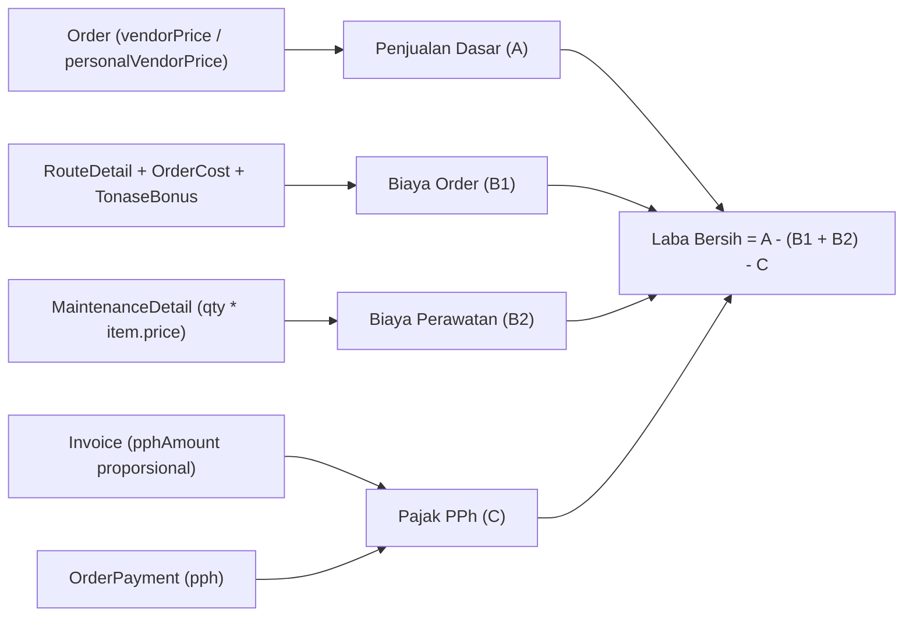

# Rencana Perbaikan & Standarisasi Laporan Laba Rugi

## Goal Description
Memperbaiki seluruh temuan pada modul **Laporan Laba Rugi** (`/report/profit-loss`) agar selaras dengan catatan review bisnis, bebas dari error runtime, dan mengikuti standar UI PHL (`phl-table-design`):
1. **Bahasa Indonesia**: Mengubah judul, breadcrumb, filter, header tabel, halaman detail, dan export Excel ke Bahasa Indonesia yang konsisten.
2. **Basic Sales mengikuti harga vendor**: Menggunakan `order.vendorPrice` jika `> 0`, dan fallback ke `order.personalVendorPrice` untuk armada internal yang masih memakai skema harga internal.
3. **Perbaikan tombol Show error**: Menangani relasi null (`route`, `costComponent`, `item`), menghapus referensi route `report.profit-loss.edit` yang tidak ada di `datatableMaintenance()`, memakai `firstOrFail()`, dan memperbaiki path asset relatif.
4. **Kolom Pajak & pengurangan Laba Bersih**: Menambahkan kolom **Pajak (PPh)** yang dihitung dari PPh `Invoice` (diproporsikan per order untuk faktur multi-order) dan `OrderPayment` (Pembayaran Langsung), serta mengurangkan pajak tersebut ke **Laba Bersih** (`Penjualan Dasar - Biaya Order - Biaya Perawatan - Pajak`).
5. **Penggantian Fleet Type ke Perusahaan Kendaraan**: Menghapus filter/kolom `Fleet Type` dan menggantinya dengan `Perusahaan Kendaraan` (`FleetCompany` via relasi `fleet.company`).
6. **Penyelarasan Biaya Order & UI PHL**: Menyamakan `Biaya Order` di tabel index, halaman detail, dan Excel (`basicAllowance + additionalCost + tonase`), serta menerapkan standar `phl-table-design` (panel filter collapse, Flatpickr, Select2 38px, KPI summary cards, dan dukungan dark mode penuh).

## Keputusan Desain (Terkonfirmasi)
- **Sumber Basic Sales**: `vendorPrice > 0 ? vendorPrice : personalVendorPrice` per order.
- **Sumber Pajak (PPh)**: PPh dari `Invoice` (proporsional per order sesuai basis `pphBaseType` invoice) dan `OrderPayment` (Pembayaran Langsung).
- **Definisi Biaya Order**: Konsisten di seluruh tampilan (`basicAllowance + additionalCost + tonase`).
- **Standar UI**: Mengikuti `phl-table-design` (filter collapse tertutup default, kontrol 38px, Flatpickr `Y-m-d`, KPI summary tiles, dark mode `html[data-bs-theme="dark"]`).

## User Review Required
> [!IMPORTANT]
> - Nama menu pada tabel database `menu` (`code = 'PROFIT_LOSS'`) saat ini masih `'Profit & Loss'`. Perubahan pada controller dan blade view tidak mengubah database `menu`; jika nama menu sidebar juga ingin diubah menjadi `'Laporan Laba Rugi'`, dapat ditambahkan update pada `menu.nama` / `menu.name` di step terpisah atau langsung saat eksekusi.
> - Perhitungan `Biaya Order` pada halaman index sebelumnya meng-comment `basicAllowance` sehingga angkanya berbeda dengan halaman Show. Penyelarasan ini akan membuat angka `Biaya Order` dan `Laba Bersih` di index, Show, dan Excel menjadi identik.

## Daftar & Tautan Action Step-by-Step

| Step | Judul Langkah | Target File Utama | Status | Dokumen Detail |
|---|---|---|---|---|
| 1 | Sentralisasi perhitungan di ProfitLossService | `app/Services/Report/ProfitLossService.php` | `done` | [step-01-profit-loss-service.md](./profit-loss-report-fix/step-01-profit-loss-service.md) |
| 2 | Perbaikan & penyesuaian ProfitLossController | `app/Http/Controllers/Report/ProfitLossController.php` | `done` | [step-02-profit-loss-controller.md](./profit-loss-report-fix/step-02-profit-loss-controller.md) |
| 3 | Pembaruan Export Excel Laporan Laba Rugi | `app/Exports/ProfitLossReport.php`, `profit-loss-excel.blade.php` | `done` | [step-03-excel-export.md](./profit-loss-report-fix/step-03-excel-export.md) |
| 4 | Redesign & Bahasa Indonesia View Index & Show | `index.blade.php`, `show.blade.php` | `done` | [step-04-views-and-ui.md](./profit-loss-report-fix/step-04-views-and-ui.md) |
| 5 | Pengujian Otomatis & Verifikasi Akhir | `tests/Unit/ProfitLossCalculationTest.php`, `tests/Feature/ProfitLossReportTest.php` | `done` | [step-05-tests-and-verification.md](./profit-loss-report-fix/step-05-tests-and-verification.md) |

## Verification Plan
- **Automated Tests**:
  - `php artisan test tests/Unit/ProfitLossCalculationTest.php tests/Feature/ProfitLossReportTest.php`
  - `php artisan test` (memastikan tidak ada regresi pada test suite eksisting)
  - `php -l app/Services/Report/ProfitLossService.php app/Http/Controllers/Report/ProfitLossController.php app/Exports/ProfitLossReport.php`
- **Manual Verification**:
  - Buka `/report/profit-loss` dalam mode terang & gelap, uji filter `Plat Nomor`, `Perusahaan Kendaraan`, `Dari Tanggal`, `Sampai Tanggal`, dan tombol Reset.
  - Klik tombol **Lihat Detail (Show)** pada armada yang memiliki maintenance aktif dan order dengan `route`/`costComponent` null; pastikan halaman tampil tanpa error 500 maupun Ajax error.
  - Verifikasi nilai `Penjualan Dasar`, `Biaya Order`, `Biaya Perawatan`, `Pajak (PPh)`, dan `Laba Bersih` konsisten antara tabel index, halaman detail, dan file export Excel.
