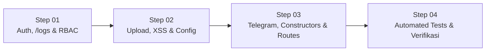

# Rencana Perbaikan Keamanan, Bug & Automated Testing

> **Status:** `done` (Step 01 s.d. Step 04 selesai)
> **Walkthrough:** [./security-and-bugfix/walkthrough.md](./security-and-bugfix/walkthrough.md)
> **Target:** Hardening keamanan, perbaikan bug HTTP 500 & broken routes, serta Feature/Security Tests pasca upgrade Laravel 13.43.0
> **Struktur:** Dokumen ini adalah **file plan utama**; detail eksekusi tiap langkah dipecah ke dalam folder [`./security-and-bugfix/`](./security-and-bugfix/).

---

## Goal Description
Menindaklanjuti hasil audit dan pengujian pasca upgrade **Laravel 13.43.0**, rencana ini bertujuan menutup celah keamanan kritis/tinggi, memperbaiki bug yang menyebabkan error HTTP 500 dan broken route, menstandarkan penanganan konfigurasi/upload, serta membangun **Feature & Regression Test Suite** agar setiap celah dan jalur kritis tervalidasi secara otomatis.



---

## User Review Required

> [!CAUTION]
> **Aktivasi RBAC (`RoleAccess`) Berisiko Memblokir Route yang Belum Terdaftar di Tabel `menu`/`role_menu`**
> Saat ini `app/Http/Middleware/RoleAccess.php` masih kosong (`return $next($request);`) sehingga seluruh user login dapat mengakses URL apa saja secara langsung. Jika `RoleAccess` langsung diaktifkan pada seluruh route berdasarkan kecocokan URL tabel `menu`, route AJAX/DataTables/action (seperti `datatable/*`, `ajax/*`, `store`, `update`, `export`) yang URL-nya tidak persis sama dengan URL menu berisiko ikut terblokir (403) kecuali dipetakan dengan prefix/nama route atau role-based middleware yang jelas.

> [!IMPORTANT]
> **Pembatasan `/logs` (`LogViewerController`)**
> Route `/logs` pada `routes/web.php` akan dibatasi hanya untuk role admin (`SPRADMIN` / `System Administrator`) agar user operasional tidak bisa melihat, mengunduh, atau menghapus log aplikasi.

---

## Open Questions *(Terjawab & Diterapkan)*

Keputusan yang dikonfirmasi dan sudah dieksekusi:
1. **Skema Penegakan `RoleAccess` RBAC:** **Opsi A** — middleware `access` diterapkan secara eksplisit pada `/logs`, `/administrator/*`, `/bank/*`, dan `/report/profit-loss` dengan bypass `SPRADMIN` / `System Administrator`.
2. **Tiga Custom Route yang Method-nya Tidak Ada (`check-order-null-relation`, `bon-ujt-order-detail`, `store-balance`):** Dihapus beserta dead code view/method terkait.
3. **Integrasi Telegram:** Seluruh integrasi Telegram bot webhook/notifikasi yang tidak terpakai dihapus bersih.

---

## Peta Action Step-by-Step

| Step | File Action | Fokus Utama | Target File Utama | Status |
| :--- | :--- | :--- | :--- | :--- |
| **Step 01** | [step-01-auth-and-rbac.md](./security-and-bugfix/step-01-auth-and-rbac.md) | Amankan `/change-password`, batasi `/logs`, implementasi `RoleAccess` | `routes/auth.php`, `routes/web.php`, `RoleAccess.php` | `done` |
| **Step 02** | [step-02-upload-xss-and-config.md](./security-and-bugfix/step-02-upload-xss-and-config.md) | Validasi upload, sanitasi error/XSS, pindah `env()` ke `config/services.php`, SSL verify | `CompanySettingController`, `FleetController`, `alert.blade.php`, `SendNotif` | `done` |
| **Step 03** | [step-03-telegram-constructors-and-routes.md](./security-and-bugfix/step-03-telegram-constructors-and-routes.md) | Hapus integrasi Telegram yang tidak dipakai, null-safe constructor, rapikan broken routes | controller constructors, `routes/*.php`, `SendNotif` | `done` |
| **Step 04** | [step-04-automated-tests-and-verification.md](./security-and-bugfix/step-04-automated-tests-and-verification.md) | Buat `SecurityAndAuthTest`, `RouteHealthTest` & verifikasi penuh | `tests/Feature/*` | `done` |

---

## Verification Plan (Akhir Keseluruhan — `Verified`)

Setelah Step 01 s.d. Step 04 selesai:
```bash
php artisan optimize:clear
php artisan view:cache && php artisan view:clear
php artisan test
composer audit --no-interaction
```
- **Hasil Terverifikasi:**
  - `RouteHealthTest`: **0 broken routes**, seluruh controller ter-instantiate dengan `Auth::user() === null`, seluruh route non-whitelist terlindungi middleware `auth`/`guest`.
  - `php artisan test`: **51 passed (298 assertions)** — `43` unit/feature existing + `8` feature test baru ([SecurityAndAuthTest.php](../../tests/Feature/SecurityAndAuthTest.php) & [RouteHealthTest.php](../../tests/Feature/RouteHealthTest.php)).
  - `php artisan view:cache && php artisan view:clear`: seluruh template Blade terkompilasi tanpa error.
  - `composer audit --no-interaction`: `No security vulnerability advisories found.`
