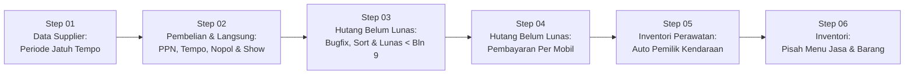

# Plan Utama: Perbaikan & Pengembangan Modul Supplier dan Inventori

## Goal Description

Rencana implementasi menyeluruh berdasarkan catatan kebutuhan pada grup menu **Supplier** dan **Inventori**:

1. **Data Supplier (`inventory/supplier`):** Menambahkan field **Periode Jatuh Tempo Pembayaran (hari)** pada master supplier beserta tampilan tabel, modal CRUD, dan export.
2. **Pembelian (`purchasing/purchase`) & Pembelian Langsung (`purchasing/direct-purchase`):**
   - Jatuh tempo (`dueDate`) terisi otomatis berdasarkan `Tanggal Pembelian + Periode Jatuh Tempo Supplier` (tetap bisa diubah manual).
   - Menambahkan kolom & kalkulasi **PPN** (otomatis mengikuti tarif PPN master supplier, dapat diedit di form) serta **Jumlah Setelah PPN** yang menjadi nilai tagihan resmi (`nominal`) ke Hutang Supplier.
   - Menambahkan **Tombol Show** yang selalu tampil di daftar Pembelian (seragam dengan Pembelian Langsung).
   - Menambahkan pilihan **Nopol** (opsional di Pembelian PO, wajib di Pembelian Langsung) yang ketika dipilih otomatis menampilkan **Nama Pemilik Kendaraan** (`fleet.company.name`).
3. **Hutang Belum Lunas (`purchasing/purchase-payment`):**
   - Memperbaiki error fatal DataTables (`Invalid column name: "".` akibat kolom checkbox `data: null`), error export PDF (`Mpdf pcre.backtrack_limit`), dan error JS pada halaman Hutang Lunas (`escapeHtml is not defined`).
   - Mengurutkan daftar berdasarkan **hutang paling lama** (`ASC`) baik pada rekap per supplier maupun daftar PO per supplier.
   - Melunasi otomatis seluruh transaksi hutang **sebelum bulan 9 (`date < '2026-09-01'`)** menjadi `Paid` tanpa memotong saldo Kas & Bank.
   - Menampilkan **jumlah tagihan & pembayaran masing-masing mobil** apabila dalam 1 invoice/PO terdapat barang yang dipakai oleh beberapa mobil (dihitung akurat dari alokasi `MaintenanceFifo`).
4. **Inventori — Perawatan (`warehouse/maintenance`):** Ketika memilih Nopol armada, otomatis menampilkan **Nama Pemilik Kendaraan** (`fleet.company.name`) di form Create/Edit, tabel, modal detail, dan export.
5. **Inventori — Pemisahan Menu Jasa & Barang (`inventory/items` & `inventory/jasa`):** Memisahkan menu master **Jasa** (`Item::TYPE_JASA`) dari menu **Barang** (`Item::TYPE_PART`) menjadi dua menu tersendiri di bawah grup Inventori.

---

## User Review Required & Keputusan Terkonfirmasi

> [!IMPORTANT]
> **Keputusan Bisnis Terkonfirmasi:**
> 1. **Pelunasan Hutang Sebelum Bulan 9 (`date < '2026-09-01'`):** Hanya mengubah status PO belum lunas sebelum `2026-09-01` menjadi **Lunas** (`paymentStatus = 'Paid'`, `paidAmount = nominal`, `status = 3`, `paymentDate = COALESCE(paymentDate, dueDate, date)`) melalui migration data **tanpa memotong saldo Kas & Bank (`live_mutation` / `mutation`)**.
> 2. **Aturan PPN Pembelian & Pembelian Langsung:** Tarif PPN otomatis terisi dari `supplier.ppn` saat memilih supplier (tetap dapat diedit di form), menghasilkan `subtotal` (DPP), `ppn_rate`, `ppn_amount`, dan `nominal` (**Jumlah Setelah PPN**) yang menjadi dasar tagihan di **Hutang Belum Lunas** maupun **Laporan Supplier**. Data lama tetap kompatibel (`ppn_rate = 0`, `ppn_amount = 0`, `subtotal = nominal`).
> 3. **Nopol & Pemilik Kendaraan di Pembelian:** Pilihan Nopol (`fleetCode`) ditambahkan secara **opsional** di Pembelian (PO) dan tetap **wajib** di Pembelian Langsung; keduanya otomatis menampilkan **Nama Pemilik Kendaraan** (`fleet.company.name`).

> [!WARNING]
> **Dampak Data Historis (Step 03):**
> Migration pelunasan historis akan memperbarui sekitar ~2.400 PO periode `2025-11` s/d `2026-08` yang masih berstatus `Unpaid` / `Partial` menjadi `Paid`. Kolom `paymentCode` akan ditandai khusus (mis. `'HIST-PRE-202609'`) agar mudah diaudit maupun di-*rollback* bila diperlukan tanpa mengganggu batch pembayaran kas/bank reguler.

---

## Daftar & Tautan Action Step-by-Step

| Step | Judul | Target File Utama | Status | Action File |
| :---: | :--- | :--- | :---: | :--- |
| 01 | Data Supplier: Periode Jatuh Tempo Pembayaran | Migration `supplier`, `Supplier.php`, `SupplierController.php`, `inventory/supplier/index.blade.php`, `SupplierExport.php` | `done` | [step-01-data-supplier-periode-jatuh-tempo.md](./supplier-dan-inventori-perbaikan/step-01-data-supplier-periode-jatuh-tempo.md) |
| 02 | Pembelian & Pembelian Langsung: Auto Jatuh Tempo, PPN, Show & Nopol Pemilik | Migration `purchase`, `PurchaseService.php`, `DirectPurchaseService.php`, `PurchaseController.php`, `DirectPurchaseController.php`, views & exports | `done` | [step-02-pembelian-dan-pembelian-langsung-ppn-tempo-nopol-show.md](./supplier-dan-inventori-perbaikan/step-02-pembelian-dan-pembelian-langsung-ppn-tempo-nopol-show.md) |
| 03 | Hutang Belum Lunas: Perbaikan Error, Sort Terlama & Pelunasan Sebelum Bulan 9 | `PurchasePaymentController.php`, `PurchasePaymentService.php`, `purchase-payment/index.blade.php`, `supplier-summary.blade.php`, `paid.blade.php`, Migration pelunasan | `done` | [step-03-hutang-belum-lunas-bugfix-sort-dan-pelunasan-historis.md](./supplier-dan-inventori-perbaikan/step-03-hutang-belum-lunas-bugfix-sort-dan-pelunasan-historis.md) |
| 04 | Hutang Belum Lunas: Rincian Pembayaran Masing-Masing Mobil per Invoice/PO | `PurchasePaymentService.php`, `PurchasePaymentController.php`, `purchase-payment/index.blade.php`, `partials/detail-modal*.blade.php`, `PurchasePaymentExport.php` | `done` | [step-04-hutang-belum-lunas-rincian-pembayaran-per-mobil.md](./supplier-dan-inventori-perbaikan/step-04-hutang-belum-lunas-rincian-pembayaran-per-mobil.md) |
| 05 | Inventori Perawatan: Auto-Fill Nama Pemilik Kendaraan saat Pilih Nopol | `MaintenanceController.php`, `MaintenanceService.php`, `warehouse/maintenance/create.blade.php`, `edit.blade.php`, `index.blade.php`, `MaintenanceExport.php` | `done` | [step-05-inventori-perawatan-pemilik-kendaraan.md](./supplier-dan-inventori-perbaikan/step-05-inventori-perawatan-pemilik-kendaraan.md) |
| 06 | Inventori: Pemisahan Menu Jasa & Barang serta Pengujian Terintegrasi | Migration `menu`, `MenuSeeder.php`, `routes/inventory.php`, `ItemController.php`, `ServiceItemController.php`, `inventory/jasa/*`, Feature Tests | `done` | [step-06-inventori-menu-jasa-terpisah-dan-verifikasi.md](./supplier-dan-inventori-perbaikan/step-06-inventori-menu-jasa-terpisah-dan-verifikasi.md) |

---

## Verification Plan (Akhir)

1. **Syntax & Blade Compilation Check:** Jalankan `php -l` pada seluruh file PHP baru/diubah dan uji kompilasi seluruh file Blade terkait.
2. **Database Migration & Route Check:** Jalankan `php artisan migrate --status` dan `php artisan route:list` untuk memastikan skema dan route terdaftar bersih.
3. **Automated Tests:** Jalankan Feature & Unit Tests baru beserta regresi (`php artisan test`) mencakup kalkulasi PPN PO, jatuh tempo supplier, pelunasan sebelum bulan 9, alokasi pembayaran multi-mobil (`MaintenanceFifo`), DataTables Hutang Belum Lunas, dan pemisahan menu Barang vs Jasa.
4. **Code Formatting & UI Check:** Jalankan `vendor/bin/pint --dirty` serta verifikasi tampilan light & dark mode sesuai standar `phl-table-design` dan pencarian global sesuai `datatable-search-standard`.
